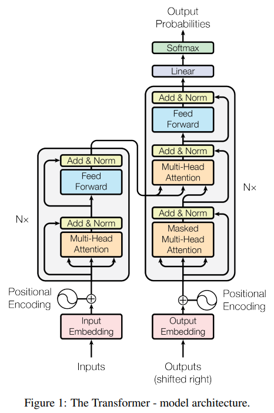
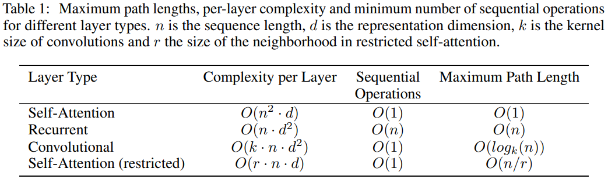

# Attention Is All You Need

분야: NLP, Transformer

[논문링크](https://arxiv.org/pdf/1706.03762)

[배경지식](배경지식.md)

# 0. Abstract

기존의 시퀀스 변환 모델들은 인코더, 디코더를 포함한 복잡한 RNN, CNN을 기반으로 하였고, 이들은 Attention으로 보강됨.

이 논문에서는 RNN과 CNN을 제거하고 Attention으로만 구성된 Transformer를 제안한다.

→ 성능 향상, 병렬 처리 가능, 학습 효율 증가의 효과를 보임

# 1. Introduction

> This inherently sequential nature precludes parallelization within training examples, 
which becomes critical at longer sequence lengths, as memory constraints limit batching across examples.
> 

Recurrent model의 한계 : 순차적인 특성으로 인해 훈련에서 병렬화 불가해서 긴 시퀀스에 제약이 발생

> Attention mechanisms have become an integral part of compelling sequence modeling and transduction models in various tasks, 
allowing modeling of dependencies without regard to their distance in the input or output sequences.
such attention mechanisms are used in conjunction with a recurrent network.
> 

Attention mechanism은 Recurrent model을 보완하여 입력, 출력 시퀀스의 거리에 상관없이 timestep에 따른 종속성 모델링 가능하며, RNN을 같이 사용한다.

> In this work we propose the Transformer, a model architecture eschewing recurrence and instead relying entirely on an attention mechanism
to draw global dependencies between input and output.
> 

이 연구에서 RNN을 제거하고 Attention mechanism에만 기반하여 입출력 사이의 전역 종속성을 설계하는 모델인 Transformer을 제안한다. 
* 전역종속성 : 시퀀스 전체에 걸친 의존관계

# 2. Background

> The goal of reducing sequential computation also forms the foundation of the models, all of which use convolutional neural networks as basic building
block, computing hidden representations in parallel for all input and output positions. 
In these models, the number of operations required to relate signals from two arbitrary input or output positions grows
in the distance between positions, linearly and logarithmically.
> 

순차계산을 줄이고자 CNN기반의 모델들이 제안되었고, 모든 입출력의 위치에 대하여 hidden representations을 병렬로 계산.
그러나 임의의 두 위치를 연결하는데에 필요한 연산수가 모델에 따라 거리에 비례하거나 로그적으로 증가

> Transformer this is reduced to a constant number of operations, albeit at the cost of reduced effective resolution 
due to averaging attention-weighted positions, an effect we counteract with Multi-Head Attention
> 

Transformer는 이 연산수를 상수로 줄였으나, 서로 다른 위치정보는 희석될 수 있다. 이것은 Multi-Head Attention으로 완화한다.

> Self-attention, sometimes called intra-attention is an attention mechanism relating different positions of a single sequence 
in order to compute a representation of the sequence.
> 

Self-attention은 하나의 시퀀스 내의 서로 다른 위치들 사이의 관계를 파악하여 시퀀스의 의미를 계산

# 3. Model Architecture

인코더 : 입력 시퀀스 $(x_1, \ldots, x_n)$를 벡터 $\mathbf{z} = (z_1, \ldots, z_n)$로 바꿈. 이것은 입력시퀀스의 의미를 가짐.

디코더 : 인코더에서 생성한 $\mathbf{z}$로 출력 시퀀스 $(y_1, \ldots, y_n)$를 순차적으로 생성.

각각의 순서에서 모델은 자기회귀적(Auto-regressive)으로 동작함. 즉, 다음 출력에 이전 출력을 사용.

## 3.1 Encoder and Decoder Stacks

① **Encoder** 

인코더는 6개의 동일한 레이어를 쌓아 만들어짐.
각 레이어는 멀티 헤드 셀프어텐션 (multi-head self-attention)과 위치별 피드포워드(position-wise fully connected feed-forward) 두 개의 서브 레이어로 구성됨.
각 서브레이어는 잔차연결 및 레이어 정규화가 적용됨.

② **Decoder**

6개의 동일한 레이어를 쌓아 만들어짐.
레이어는 인코더의 두 서브레이어에 인코더 스택의 출력에 대하여 멀티헤드 어텐션을 수행하는 서브레이어가 추가됨
인코더와 마찬가지로 각 레이어에 잔차연결과 레이어 정규화 적용.
디코더의 셀프어테션에는 마스킹 기법이 적용되는데, 현재 시점에서 과거의 정보들만을 토대로 예측하도록 하는 기법. 즉, 미래의 정답을 보고 예측하는 것을 차단함.

## 3.2 Attention

어텐션 함수는 Query, Key-Value쌍을 입력받아서 출력을 생성. 출력은 Value의 가중합으로 계산되고, 가중치는 Query와 Key 사이의 compatibility(적합도)를 계산하는 함수로 계산됨.

### 3.2.1 Scaled Dot-Product Attention

Query와 Key의 차원 $d_k$, Value의 차원 $d_v$

$$\text{Attention}(Q,K,V) = \text{softmax}\left(\frac{QK^\top}{\sqrt{d_k}}\right)V$$

$d_k$로 scaling하는 이유 : $d_k$가 너무 커지면 내적값($QK^T$)가 너무 커지고, 이를 softmax로 통과시키면 gradient가 너무 작아지기 때문

### 3.2.2 Multi-Head Attention

$d_{\text{model}}$차원의 Q, K, V를 단일 Attention함수에 적용하는 것 보다 $h$(여기서는 8)번에 나누어 병렬적으로 어텐션을 수행하여 다시 결과를 합치는 것.

## 3.3 Position-wise Feed_Forward Networks

- 인코더와 디코더의 각 계층에는 위치별로 독립적이고 동일한 방식의 FFN이 포함된다.
    
$$\text{FFN}(x) = \max(0, xW_1+b_1)W_2+b_2$$
    
- 서로 다른 위치에 적용되는 선형 변환은 동일하지만, 다른 파라미터를 사용하기에 출력은 다름
    - 서로 다른 토큰 $x_1$, $x_2$, $x_3$에 대해 각각 FFN을 적용함.
    $W_1$, $W_2$, $b_1$, $b_2$는 세 위치에서 모두 같으나 입력이 다르기에 출력이 달라진다는 의미.
- 입출력의 차원은 512이며, 내부에서는 2048차원.
    - $xW_1+b_1$에서 차원은 $512 \rightarrow 2048$
    - $\max(0, xW_1+b_1)W_2+b_2$에서 차원은 $2048 \rightarrow 512$

## 3.4 Embedding and Softmax

- **Embedding** : 입력과 출력 토큰을 $d_{\text{model}}$차원의 벡터로 변환
- **Linear transformation + Softmax** : 디코더의 출력을 다음토큰의 예측 확률로 변환
- **Sharing Weights** : 입/출력 임베딩, softmax전의 선형변환 가중치를 공유, 임베딩 계층에서는 가중치에 $\sqrt{d_{\text{model}}}$을 곱함

## 3.5 Positional Encoding

- RNN, CNN처럼 단어를 순차적으로 입력받지 않기에 모델에 위치정보를 알려줘야함 → 위치 인코딩 값을 더함으로 해결
    
$$ PE_{(pos,2i)}=\sin\left(\frac{pos}{10000^{2i/d_{\text{model}}}}\right)$$

$$PE_{(pos,2i+1)}=\cos\left(\frac{pos}{10000^{2i/d_{\text{model}}}}\right)$$
    
- 위치 인코딩의 각 차원은 하나의 사인파(sinusoid)에 대응함
- 위치 $pos$에 대한 인코딩 벡터 $PE_{pos}$가 있으면 고정된 간격 $k$만큼 떨어진 위치의 인코딩 벡터 $PE_{pos+k}$를 $PE_{pos}$의 선형 변환으로 나타낼 수 있음
    - 삼각함수의 덧셈정리는 선형변환으로 표현 가능함.

    $$\begin{bmatrix} \sin(a+b) \\ \cos(a+b) \end{bmatrix} = \begin{bmatrix} \cos b & \sin b \\ -\sin b & \cos b \end{bmatrix} \begin{bmatrix} \sin a \\ \cos a \end{bmatrix}$$

    - 여기서 $\omega_i = 10000^{-\frac{2i}{d_{\text{model}}}}$, $a = pos \cdot \omega_i$, $b = k \cdot \omega_i$를 대입하면

    $$\begin{bmatrix} PE(pos+k, 2i) \\ PE(pos+k, 2i+1) \end{bmatrix} = \begin{bmatrix} \cos(k\omega_i) & \sin(k\omega_i) \\ -\sin (k\omega_i) & \cos(k\omega_i) \end{bmatrix} \begin{bmatrix} PE(pos, 2i) \\ PE(pos, 2i+1) \end{bmatrix} $$
        
- 학습가능한 위치 임베딩(learned positional embeddings)를 사용할 수 있지만,  두 방식은 거의 동일한 성능을 보였음
- 위 방식을 선택한 이유는 sin파를 사용하기에 학습 중 접하지 않았던 길이의 시퀀스에 대해서도 일반화하여 처리할 가능성이 있기 때문.
    - 만일 길이가 100짜리인 시퀀스를 학습한다고 할 때
    learned positional embedding은 각 위치에 대한 임베딩을 학습하기에 100을 넘어가는 시퀀스에 대해서는 그대로 적용하기 어려우나
    sinusoidal positioning embedding은 수식으로 인코딩을 계산하기에 100을 넘어가도 임베딩이 가능함.

# 4. Why Self-Attention

- 비교기준
    
    ① 계산복잡도
    ② 병렬화
    ③ 경로 길이
    
1. RNN vs. Self-Attention
    - 시퀀스 길이($n$)가 임베딩 차원($d$)보다 작으면 Self-Attention이 빠름
    - RNN은 순차연산이 $O(n)$인 반면, Self-Attention은 $O(1)$
2. CNN vs. Self-Attention
    - 커널 너비($k$)가 $n$보다 작으면($k<n$) 모든 입/출력 위치의 쌍을 연결하지 못함.
    - 멀리 떨어져 있는 단어 간 정보는 층을 여러개 쌓아야 알 수 있음.
        
        필요한 층 개수 : $O(n/k)$, Dilated Convolution 사용시 : $O(\log_k n)$
        
    - 합성곱층은 일반적으로 RNN의 계산비용보다 $k$배 더 큼. 그러나 Seperable Convolution 사용시 $O(knd+nd^2)$으로 줄일 수 있음
        
        $k=n$이면 논문의 모델과 복잡도가 같긴 함(Seperable Convolution)